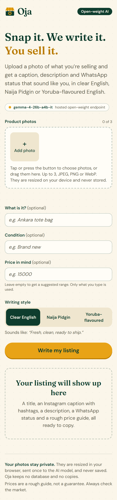
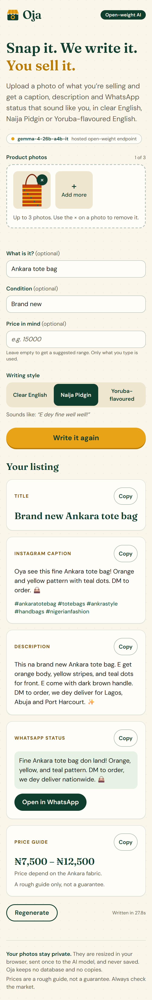

# Oja

Listing writer for small Nigerian sellers on Instagram and WhatsApp. Upload 1 to 3 product photos, add optional hints, pick a voice (Clear English, Naija Pidgin or Yoruba-flavoured English) and get a title, caption with hashtags, description, WhatsApp status and a rough price guide, ready to copy.

Built with Next.js (App Router), TypeScript (strict), Tailwind CSS and Framer Motion. The AI is any open-weight vision model behind an OpenAI-compatible endpoint; the default is `gemma3:4b` on local Ollama.

<p>
  
  
</p>

The second screenshot is one real generation from `gemma3:4b` on local Ollama (CPU only), not a mock-up.

## Run locally

```powershell
ollama pull gemma3:4b
ollama serve          # skip if Ollama is already running
pnpm install
pnpm dev              # http://localhost:3000
```

Other scripts: `pnpm test`, `pnpm lint`, `pnpm typecheck`, `pnpm build`, and (with the app running on port 3010) `pnpm a11y` and `node scripts/bench.mjs` for the accessibility and latency checks.

## Environment variables

Copy `.env.example` to `.env.local` if you want to change anything.

| Variable | Default | Purpose |
| --- | --- | --- |
| `AI_BASE_URL` | `http://localhost:11434/v1` | OpenAI-compatible base URL (`/chat/completions` is appended) |
| `AI_MODEL` | `gemma3:4b` | Model name, must support image input |
| `AI_API_KEY` | empty | Sent as a Bearer token when set |
| `AI_TIMEOUT_SECONDS` | `300` | Per-request timeout |
| `AI_REASONING_EFFORT` | unset | Sent as `reasoning_effort` only when set. Not every endpoint or model accepts it (see Latency) |
| `AI_MAX_TOKENS` | `900` | Cap on the model's reply length |

## Using a hosted open-weight model

No code changes: set `AI_BASE_URL`, `AI_MODEL` and (if the provider needs one) `AI_API_KEY`. The key is sent as `Authorization: Bearer <key>`; with no key, no header is sent (tested both ways). The model must accept image input.

| Provider | `AI_BASE_URL` | `AI_MODEL` (example only) | `AI_API_KEY` |
| --- | --- | --- | --- |
| Local Ollama | `http://localhost:11434/v1` | `gemma3:4b` | leave empty |
| OpenRouter | `https://openrouter.ai/api/v1` | a `provider/model` slug of a vision-capable open model | OpenRouter key |
| Google AI Studio (hosted Gemma) | `https://generativelanguage.googleapis.com/v1beta/openai/` | `gemma-4-31b-it` or `gemma-4-26b-a4b-it` | Gemini API key |
| Any OpenAI-compatible provider | `https://<host>/v1` | the provider's vision model id | provider key |

What was checked (against the providers' own docs, 13 Oct 2026) and what was not:

- OpenRouter's base URL and Bearer auth are documented. Pick the model slug from `openrouter.ai/models` or `GET /api/v1/models`, and filter for image input.
- Google documents the OpenAI-compatible base URL, Bearer auth and `image_url` data URLs. Its Gemma page lists `gemma-4-31b-it` and `gemma-4-26b-a4b-it` on the Gemini API with image support. I have run `gemma-4-26b-a4b-it` through the OpenAI-compatible endpoint from this app (that is the model behind the timings below); `gemma-4-31b-it` I have not run. Treat all model names as examples and check the provider's current list.
- Hosted endpoints receive the photos you send. Only the local Ollama setup keeps them on your machine.

## How the AI layer works

- `POST /api/generate` takes `{ images: dataUrl[], hints, style }`.
- Images go in the OpenAI vision format (`image_url` parts); the model is asked for one strict JSON object.
- Output passes through markdown-fence stripping and a brace-balanced extractor, then a zod schema. If invalid, one repair call tells the model what was wrong. After that it returns a clear error.
- Small tolerances: price strings like "₦12,000" are coerced to integers, a reversed range is swapped, hashtags get a `#`.
- Prompt is compact, `max_tokens` is 900, and each style has its own voice brief with a worked example.
- The chosen voice applies to the caption, description and WhatsApp status, and the user turn restates it.
- The model first lists what it can see in a `seen` field (visible parts and colours). It grounds the copy, is validated, and is dropped from the response.
- It may not invent a collection, sizes, materials or use cases. If the photos show nothing sellable, the title starts with "No sellable product visible" and the UI shows a plain explanation instead of cards.
- Hashtags are capped at 8 and de-duplicated. The price note is one sentence about what drives the range; the UI adds the "rough guide, not a guarantee" line once.
- Only values the seller typed are sent as hints. Placeholders live in the `placeholder` attribute and cannot be sent (tested).
- Generation time and whether the repair call was needed are logged (`[oja] generated ... attempts=1 ms=`) and returned as `ms` and `attempts`.

## Decisions

- **Rate limit** is in memory, 10 requests/minute per IP; fine for one instance.
- **Body limit** 6 MB; the browser resizes to 1024px JPEG first.
- **Timeout default 300s**: on a CPU-only laptop gemma3:4b took about 2.5 minutes per listing, so a shorter default would fail regularly.
- **Price guide** is always labelled a rough guide by the UI; the model's own note is kept to what drives the range.
- **Photos stay at 1024px.** 768px was measured and rejected (see Latency).
- **No streaming**, because the output must be complete valid JSON before it is shown.
- **TypeScript 6**, since typescript-eslint does not support TS 7 yet.

## Measured generation time

Local, `gemma3:4b` on Ollama 0.40.3, 100% CPU, one 1024px photo (earlier prompt):

| Style | Server time |
| --- | --- |
| Clear English | 148.7 s |
| Naija Pidgin | 148.0 s |
| Yoruba-flavoured | 157.2 s |

A later run through the browser UI took 215 s. Expect 2.5 to 3.5 minutes on a CPU, which is why the UI shows an elapsed-seconds counter for local models.

Hosted, `gemma-4-26b-a4b-it` through Google's OpenAI-compatible endpoint, 14 Oct 2026, one product photo (838x1024 JPEG), 3 runs per style, server time in seconds (median, min to max):

| Configuration | English | Pidgin | Yoruba | Valid JSON, first try |
| --- | --- | --- | --- | --- |
| Earlier prompt, 1024px, `max_tokens` 900 | 8.3 (8.0-8.3) | 7.8 (7.6-7.8) | 7.9 (7.9-8.2) | not recorded; 7/9 calls succeeded, 2 failed upstream (HTTP 502) |
| **Current prompt, 1024px, 900 (kept)** | 11.0 (7.4-13.4) | 7.1 (6.8-7.2) | 7.6 (7.4-7.7) | 9/9 |
| Current prompt, **768px**, 900 | 26.0 (25.6-26.0) | 25.8 (25.5-26.0) | 26.9 (26.4-26.9) | 0/9 (all needed the repair call; 2 of 9 still failed) |
| Current prompt, 1024px, `max_tokens` **600** | 7.0 (6.8-7.7) | 6.5 (6.3-7.5) | 7.7 (7.3-8.0) | 9/9 |

One run through the browser UI at the end took 27.8 s on the server for a single request, so expect a spread of roughly 7 to 30 s rather than a fixed number. These are single-machine, single-day measurements against a free-tier endpoint, not a benchmark.

### Latency experiments

- **`AI_REASONING_EFFORT`** (optional, unset by default, sent only when set): this endpoint and model reject it. `low` and `medium` returned HTTP 400 "Thinking level is not supported for this model", `none` returned 400 "Thinking budget is not supported", `minimal` returned a 500. So it cannot be used with this model; it stays available for endpoints that accept it.
- **768px images**: rejected. The first reply was invalid JSON in all 9 runs, every success needed the repair call (about 26 s instead of about 8 s), and 2 of 9 failed outright. Photos stay at 1024px.
- **`max_tokens` 600 instead of 900**: valid JSON 9/9 and equivalent output, but no measurable speed-up (within run-to-run noise), so the default stays at 900 to leave headroom. `AI_MAX_TOKENS` lets you change it.
- Output quality was checked on every run with `scripts/bench.mjs`: the brown handle was mentioned 9/9, no American slang appeared, hashtag counts were 5 to 8, the price note never repeated the disclaimer, and Pidgin and Yoruba markers appeared in all three text fields. Those are regex checks plus reading samples, not a human evaluation.

## Accessibility

Built and checked against WCAG 2.2 AA criteria with automated and scripted keyboard checks (`pnpm a11y`, axe-core plus a Playwright walk-through, API mocked). **Manual testing with a screen reader (NVDA on Windows, VoiceOver on iOS) has not been done yet, so no conformance level is claimed.** Automated tools find only part of the real problems.

What the check covers: 0 axe violations in the empty, loading, result, no-product and error states; every control at least 44x44 px at 390 px wide; no horizontal overflow; visible focus on every tab stop; pointer cursor on every interactive element and not-allowed when disabled; reduced-motion honoured.

Keyboard map:

| Key | What it does |
| --- | --- |
| Tab / Shift+Tab | Add photo, then the three hint fields, then the style group (one stop), then the generate button, then the results |
| Enter or Space on "Add photo" | Opens the photo picker |
| Enter or Space on a photo's × | Removes that photo (named "Remove photo 2 of 3") |
| Left/Right (or Up/Down) in the style group | Changes the writing style |
| Enter on "Write my listing" | Generates. With no photo it says so in an alert |
| Tab after results appear | Goes from the "Your listing" heading to the first Copy button |

Decisions:

- The style picker is a native radio group in a `fieldset role="radiogroup"`, so arrow keys, announcement and the single tab stop come from the browser, not custom key handling.
- One polite live region announces "Writing your listing", "Listing ready", "Photo removed" and "Copied <field>". The rotating progress messages are deliberately not announced; they would be noise.
- When a result or error appears, focus moves to its heading (a plain `tabIndex=-1` heading, not a trap). Errors are `role="alert"`.
- The generate button uses `aria-disabled` while busy so it keeps focus instead of vanishing from the tab order.
- Headings go h1 (page), h2 (form, results, errors), h3 (each result card). Skeletons are `aria-hidden` inside an `aria-busy` region.
- Placeholders are italic with an "e.g." prefix, the hint fields have visible labels, and the price field explains that only typed text is used.
- Motion: a global `prefers-reduced-motion` rule stops CSS animation and transitions, Framer Motion uses `reducedMotion="user"`, and the scroll to results is instant when reduced motion is requested.
- Not done: a skip link (the page is short), and screen-reader testing as above.

## Privacy

Photos are resized in the browser, sent once to the model, and never written to disk or a database. Oja has no database, no accounts and no analytics. The server logs only style, image count, model and duration. With local Ollama the photos never leave your machine; with a hosted endpoint they go to that provider, and the model badge in the UI says which one is in use. `/api/health` returns only `ok`, the model name and whether it is local, never the URL or key.

## Deploy on Render

A hosted model is required: Render cannot reach Ollama on your laptop. `render.yaml` describes the service (Node 22, Frankfurt, free plan, health check `/api/health`).

Manual steps:

1. Push the repo to GitHub.
2. Render dashboard: **New > Blueprint**, pick the `oja` repo, apply. Render asks for `AI_BASE_URL`, `AI_MODEL` and `AI_API_KEY` (they are `sync: false`, so they are never in git). Use the table above.
3. Wait for the first deploy, then open `https://<service>.onrender.com/api/health`. It should return `{"ok":true,"model":"...","local":false}`.
4. Custom domain: service **Settings > Custom Domains > + Add Custom Domain**, enter `oja-ng.tech`, Save. Render also adds `www.oja-ng.tech` and redirects it to the root.
5. At your DNS provider (details below), then click **Verify** on Render and wait for the certificate.

DNS for `oja-ng.tech` (from Render's docs; confirm the values shown in your dashboard):

| Name | Type | Value |
| --- | --- | --- |
| `@` (root) | `ALIAS` or `ANAME` | `<service>.onrender.com` |
| `@` (root), if your provider has neither | `A` | `216.24.57.1` (Cloudflare: use a `CNAME` instead) |
| `www` | `CNAME` | `<service>.onrender.com` |

Remove any `AAAA` records and any domain-forwarding feature on the domain.

Notes:

- The build command is `corepack enable && pnpm install --frozen-lockfile --prod=false && pnpm build`. Corepack reads `packageManager` (`pnpm@11.1.2`) from `package.json`. `--prod=false` keeps TypeScript and Tailwind in case `NODE_ENV=production` is set at build time. `pnpm-workspace.yaml` (`allowBuilds`) is committed and was honoured in a clean clone with `NODE_ENV=production`. That clean-clone build ran on Windows; I have not run it on Render itself.
- `NODE_VERSION=22` is set in `render.yaml` (Render's default is currently newer), and `engines` in `package.json` allows 22 to 24.
- Free instances sleep after idle time, so the first request after a pause is slow.
- Optional: set `AI_TIMEOUT_SECONDS` to something shorter for hosted models.

## Why open models

Sellers pay for the output, not for a brand of model. Open weights mean you choose where it runs: free on your own machine, on a cheap hosted endpoint, or later on a local box so customer photos never leave your control. Swapping models is an env var, so the product improves whenever a better open model ships.
